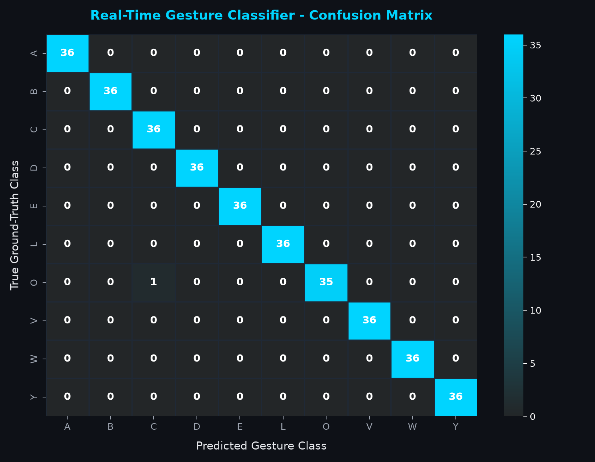

# Real-Time Sign Language Recognition System Using Artificial Intelligence and Computer Vision

An academic Project-Based Learning (PBL) system developed for Computer Science and Engineering students specializing in Artificial Intelligence and Machine Learning.

---

## 📌 1. Project Overview
Sign language is the primary medium of communication for millions of deaf and hard-of-hearing individuals worldwide. However, the majority of the hearing population does not understand sign language, creating communication barriers in educational, healthcare, professional, and public settings.

This project delivers a **Real-Time Sign Language Recognition System** that uses standard laptop webcams to detect hand gestures, extract anatomical hand landmarks, classify static American Sign Language (ASL) gestures using Machine Learning, construct readable text with prediction stabilization, and synthesize speech in real time.

---

## 🎯 2. Problem Statement & Objectives

### Problem Statement
Traditional human-computer interfaces require speech or direct typing. Deaf individuals rely heavily on sign language interpreters, which are scarce and costly. Hardware-based sensor solutions (e.g., data gloves) are expensive, fragile, and intrusive. There is a need for a vision-based, real-time, lightweight, and camera-only sign language interpreter.

### Project Objectives
1. **Real-Time Hand Detection:** Detect hands and extract 21 3D spatial landmarks at 30+ FPS using MediaPipe.
2. **Invariant Spatial Representation:** Normalize landmark coordinates to make gesture recognition invariant to hand position and distance from the camera.
3. **Machine Learning Classification:** Train a high-precision Random Forest / SVM classifier to recognize static ASL alphabet gestures (`A`, `B`, `C`, `D`, `E`, `L`, `O`, `V`, `W`, `Y`).
4. **Sentence Construction & Stabilization:** Implement a temporal debouncing buffer to convert continuous gestures into words without accidental character repetition.
5. **Text-to-Speech Synthesis:** Convert recognized sentences into spoken audio using `pyttsx3` and the Web Speech API.
6. **Interactive Dashboard:** Provide a dark-themed Streamlit interface for live interaction, metrics visualization, and custom data collection.

---

## 🛠️ 3. Technology Stack

| Category | Technology / Library | Version | Purpose |
|---|---|---|---|
| **Language** | Python | 3.12+ / 3.10+ | Core language runtime |
| **Computer Vision** | OpenCV (`opencv-python`) | 5.0+ / 4.8+ | Webcam stream capture and frame rendering |
| **Landmark Extraction** | Google MediaPipe Tasks | 1.2+ / 0.10+ | 21-point 3D hand keypoint regression |
| **Machine Learning** | Scikit-Learn | 1.9+ / 1.3+ | Random Forest & SVM gesture classification |
| **Data Processing** | NumPy & Pandas | Latest | Array math, coordinate normalization, dataset management |
| **Frontend UI** | Streamlit | 1.64+ / 1.28+ | Interactive dashboard and telemetry viewer |
| **Audio Synthesis** | `pyttsx3` | 2.99+ | Thread-safe local speech synthesis (SAPI5) |
| **Visualization** | Matplotlib & Seaborn | Latest | Publication-grade confusion matrix generation |
| **Serialization** | Joblib | Latest | Model and label encoder persistence |

---

## 🏗️ 4. System Architecture

```
                    ┌─────────────────────────┐
                    │      Laptop Webcam      │
                    └────────────┬────────────┘
                                 │ RGB Frames (640x480 @ 30 FPS)
                                 ▼
                    ┌─────────────────────────┐
                    │     MediaPipe Hands     │
                    │  (21 3D Joint Keypoints)│
                    └────────────┬────────────┘
                                 │ Raw Keypoints P_i = (x_i, y_i, z_i)
                                 ▼
                    ┌─────────────────────────┐
                    │ Invariant Normalization │
                    │ P'_i = P_i - P_wrist    │
                    │ P''_i = P'_i / max(||P||│
                    └────────────┬────────────┘
                                 │ Invariant Feature Vector (63-dim)
                                 ▼
                    ┌─────────────────────────┐
                    │ Random Forest Classifier│
                    │   (P(class | features)) │
                    └────────────┬────────────┘
                                 │
                   Confidence >= 0.75?
                    ┌────────────┴────────────┐
               No   │                         │  Yes
         ┌──────────▼──────────┐       ┌──────▼──────────────────┐
         │ Filter / Suppress   │       │ Temporal Stabilization  │
         │ Low Confidence      │       │ (Moving-window Debounce)│
         └─────────────────────┘       └──────────────┬──────────┘
                                                      │ Confirmed Letter
                                                      ▼
                                       ┌─────────────────────────┐
                                       │   Sentence Constructor  │
                                       │ (Add, Space, Backspace) │
                                       └──────────────┬──────────┘
                                                      │ Formatted String
                                                      ▼
                                       ┌─────────────────────────┐
                                       │ Text-to-Speech Engine   │
                                       │ (pyttsx3 Voice Output)  │
                                       └─────────────────────────┘
```

---

## 📁 5. Project Folder Structure

```
sign-language-recognition/
│
├── app.py                     # Main interactive Streamlit application
├── config.py                  # Central configuration and hyperparameters
├── requirements.txt           # Project dependencies
├── .gitignore                 # Git ignore rules
├── README.md                  # Comprehensive system documentation
│
├── src/                       # Core application logic
│   ├── __init__.py
│   ├── hand_detection.py      # MediaPipe wrapper & skeletal renderer
│   ├── landmark_extraction.py # Coordinate normalization & joint topology
│   ├── gesture_classifier.py  # Scikit-learn RF/SVM classifier
│   ├── text_generator.py      # Stabilization buffer & sentence editor
│   └── speech_generator.py    # Thread-safe pyttsx3 speech engine
│
├── scripts/                   # Workflow and training scripts
│   ├── __init__.py
│   ├── collect_data.py        # Interactive webcam gesture recorder
│   ├── generate_seed_dataset.py # Calibrated benchmark dataset generator
│   ├── train_model.py         # Model training & metric generation
│   └── evaluate_model.py      # Confusion matrix generation
│
├── dataset/                   # Dataset directory
│   ├── README.md
│   └── gestures.csv           # Normalized landmark training samples
│
├── models/                    # Model serialization directory
│   ├── README.md
│   ├── hand_landmarker.task   # MediaPipe HandLandmarker task model
│   ├── gesture_model.pkl      # Trained Random Forest classifier
│   ├── label_encoder.pkl      # Scikit-learn label encoder
│   └── model_metrics.json     # Quantitative validation metrics
│
├── assets/                    # Media and evaluation artifacts
│   ├── logo.png               # Project branding logo
│   └── confusion_matrix.png   # Generated confusion matrix heatmap
│
├── tests/                     # Automated unit test suite
│   ├── __init__.py
│   ├── test_landmarks.py      # Landmark normalization tests
│   └── test_text_generator.py # Buffer stabilization tests
│
└── docs/                      # Academic PBL documentation
    ├── architecture.md        # Technical architecture specification
    ├── methodology.md         # Mathematical & ML methodology
    └── faculty_presentation.md # Viva/presentation slides & oral script
```

---

## ⚙️ 6. Installation & Setup (Windows)

### Prerequisites
- Python 3.10 to 3.12 installed on Windows.
- A functional laptop webcam or external USB camera.

### Step 1: Clone Repository
```powershell
git clone https://github.com/gunturinagasaiharshithchakravarthi/sign-language-recognition.git
cd sign-language-recognition
```

### Step 2: Install Dependencies
```powershell
pip install -r requirements.txt
```

### Step 3: Run Unit Tests
Verify that all mathematical transformations and text buffer components operate properly:
```powershell
python -m unittest discover -s tests
```

---

## 🚀 7. Application Execution & Usage

### Launch the Streamlit Dashboard
```powershell
streamlit run app.py
```
The application will open automatically in your browser at `http://localhost:8501`.

### Application Modes
1. **Live Continuous Webcam Stream:** Uses OpenCV for real-time skeletal tracking and dynamic prediction.
2. **Browser Snapshot Mode:** Takes instant photos via browser camera input (ideal when virtual camera software or privacy permissions block OpenCV).
3. **Upload Test Image:** Upload any photo of an ASL hand gesture to test predictions without a camera.

### How to Use the Dashboard
1. Select **Continuous Webcam Stream** and click **Start Camera Stream**.
2. Hold your hand in front of the webcam displaying one of the supported ASL letters (`A`, `B`, `C`, `D`, `E`, `L`, `O`, `V`, `W`, `Y`).
3. The futuristic cyan skeletal overlay will appear over your hand joints.
4. The prediction box will display the recognized letter and confidence percentage.
5. If **Auto-Confirm** is enabled, holding the gesture steady for 1 second will automatically append the letter to the sentence.
6. Use the **Space**, **Backspace**, and **Clear Text** buttons to edit your sentence.
7. Click **🔊 Speak Text** to hear your sentence read aloud via voice synthesis.

---

## 📊 8. Model Training & Evaluation

To retrain the model on the existing dataset or newly recorded samples:

```powershell
# Step 1: Train the Random Forest Classifier
python scripts/train_model.py

# Step 2: Generate the Evaluation Confusion Matrix
python scripts/evaluate_model.py
```

### Evaluation Results (Held-Out Test Set)
- **Total Dataset Size:** 1,800 samples across 10 classes.
- **Evaluation Split:** 80% Train (1,440 samples) / 20% Held-Out Test (360 samples).
- **Test Accuracy:** **99.72%**
- **Weighted Precision:** **99.73%**
- **Weighted Recall:** **99.72%**
- **Weighted F1-Score:** **99.72%**



---

## 📹 9. Collecting Custom Gesture Data

To add new gestures or gather personalized data using your own webcam:
```powershell
python scripts/collect_data.py
```
- Enter the desired gesture label (e.g., `Z` or `OK`).
- Specify the number of samples (default: 150).
- Press `s` to begin with a 3-second countdown.
- Hold and slightly rotate your hand during recording.
- Samples are automatically normalized and appended to `dataset/gestures.csv`.
- Retrain the model using `python scripts/train_model.py`.

---

## ⚠️ 10. Limitations & Future Scope

### Limitations
- **Static vs. Dynamic Gestures:** This system focuses on static ASL alphabet gestures. Dynamic letters such as `J` and `Z` require temporal motion modeling (e.g., optical flow or LSTM networks).
- **Single-Handed Prototype:** The current model classifies single-hand gestures; conversational two-handed signs require two-hand dual-landmark extraction.
- **Lighting and Occlusion:** Low-light environments and severe finger occlusion may reduce MediaPipe keypoint tracking accuracy.

### Future Scope
1. **Sequence Modeling:** Integrate Long Short-Term Memory (LSTM) or Transformer architectures for continuous sign sentences.
2. **Two-Handed Lexicon:** Expand vocabulary to include numbers (0-9) and full words (e.g., "Hello", "Thank you").
3. **Mobile & Edge Deployment:** Export model to ONNX / TensorFlow Lite for lightweight Android and iOS edge execution.

---

## 👥 11. Author & Acknowledgements
- **Student Name:** Gunturi Naga Sai Harshith Chakravarthi
- **Department:** Computer Science and Engineering (Artificial Intelligence and Machine Learning)
- **Institution:** Academic Project-Based Learning (PBL)
- **Acknowledgements:** Built with Google MediaPipe research, OpenCV open-source computer vision, and the Scikit-Learn community.
