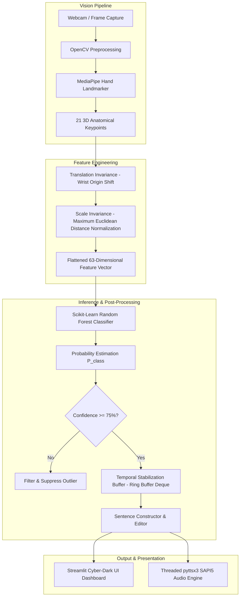

# Technical Architecture Specification

## 1. System Design Goals
The Real-Time Sign Language Recognition System is architected to achieve:
1. **Low Latency (< 33 ms per frame):** Enabling 30+ frames-per-second real-time tracking on standard commodity CPU hardware without requiring dedicated discrete GPUs.
2. **Environmental Robustness:** Invariance to background clutter, ambient lighting variations, skin tone differences, and user distance from the camera.
3. **Decoupled Architecture:** Clean separation of concerns between vision capture, geometric feature regression, machine learning inference, sentence stabilization, and graphical presentation.

---

## 2. Component Architecture

---

## 3. Module Breakdown

### 3.1 `src/hand_detection.py` (`HandDetector`)
- Uses Google MediaPipe Tasks API (`HandLandmarker`) with `models/hand_landmarker.task`.
- Executes single-image inference in RGB color space.
- Renders glowing cybernetic skeleton overlay on BGR video frames with keypoint node highlights.

### 3.2 `src/landmark_extraction.py`
- Converts 21 raw $(x, y, z)$ MediaPipe landmarks into a scale- and translation-invariant normalized representation:
  $$\mathbf{P}'_i = \mathbf{P}_i - \mathbf{P}_0$$
  $$\mathbf{P}''_i = \frac{\mathbf{P}'_i}{\max_j \|\mathbf{P}'_j\|}$$
- Retains 63 invariant floating-point coordinates.

### 3.3 `src/gesture_classifier.py` (`GestureClassifier`)
- Encapsulates Random Forest Classifier with 120 estimators and maximum depth of 15.
- Computes calibrated posterior class probabilities via `predict_proba`.
- Provides confidence threshold gating: if $\max P(\text{class} \mid \mathbf{x}) < \tau$ (where $\tau = 0.75$), the prediction is discarded as uncertain.

### 3.4 `src/text_generator.py` (`TextGenerator`)
- Implements a moving-window ring buffer of size $N = 8$.
- Confirms a letter only when $N$ consecutive predictions are identical and debounce cooldown is satisfied.
- Manages string state (append, space, backspace, clear).

### 3.5 `src/speech_generator.py` (`SpeechGenerator`)
- Runs Microsoft SAPI5 / `pyttsx3` asynchronously in a dedicated daemon worker thread.
- Automatically handles Windows COM initialization (`pythoncom.CoInitialize()`) and uninitialization per thread.
- Prevents UI blocking during speech output.
